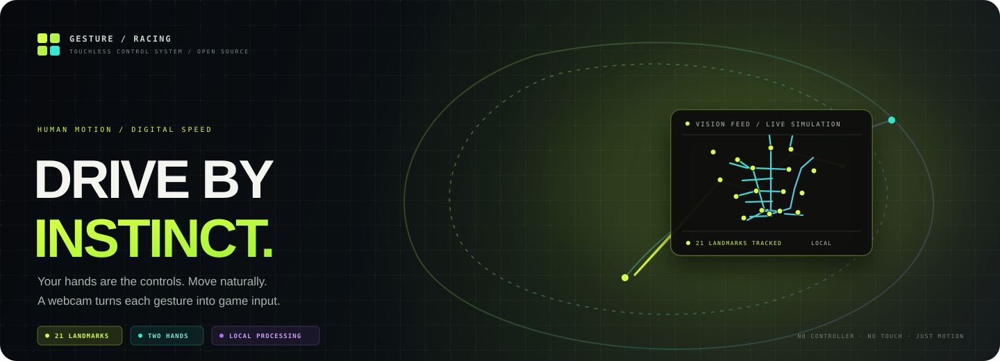
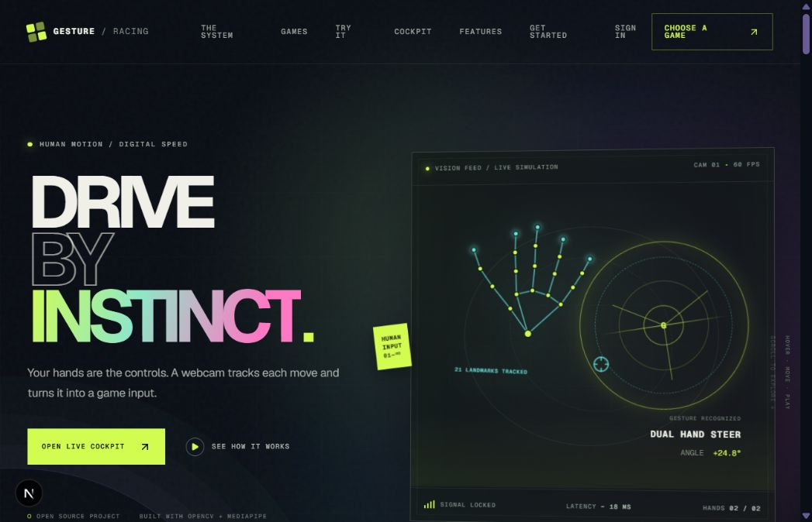
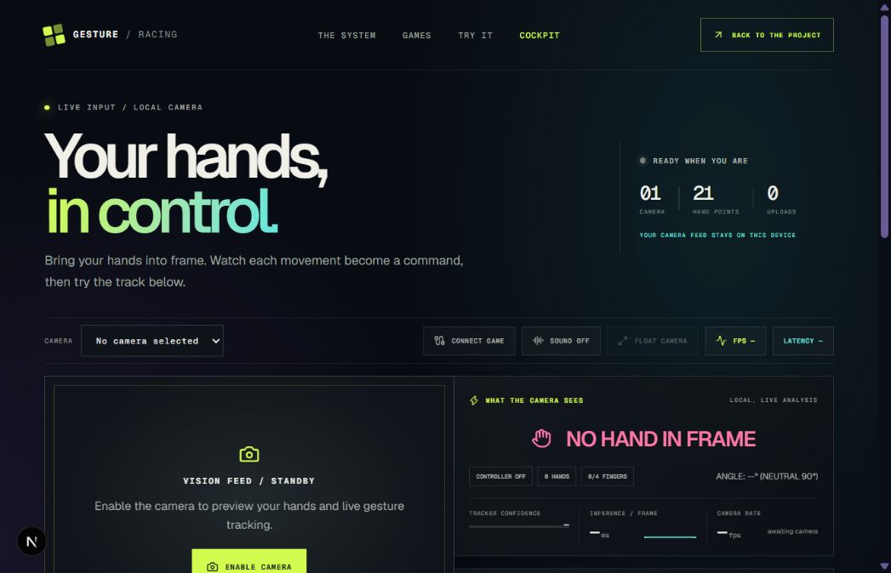

  <a href="https://website-jet-tau-52.vercel.app/"><strong>Open the project website ↗</strong></a>
  &nbsp;·&nbsp;
  <a href="https://website-jet-tau-52.vercel.app/dashboard"><strong>Launch the live cockpit ↗</strong></a>
  &nbsp;·&nbsp;
  <a href="https://github.com/varanasisatya/gesture-racing-controller"><strong>View source ↗</strong></a>

---

## A new way to drive

**Gesture / Racing** turns webcam-tracked hand movements into game controls. It pairs a polished web experience and live cockpit with a Windows controller that can send keyboard input to the game in focus.

Move your hands. See each pose recognized. Steer, accelerate, reverse, brake, and trigger nitro without holding a controller.

> **Camera frames stay on the device.** Browser hand tracking runs locally. The optional Windows bridge accepts control messages on loopback and sends game input on the player's computer.

## See the project

These camera-free captures show the current website and cockpit. The cockpit preview is in standby; camera access is only requested when a player chooses to enable it.

<table>
  <tr>
    <td width="50%" align="center">
      
       <strong>01 / PROJECT WEBSITE</strong> Animated landing page, gesture map, game profiles, and keyboard practice track.
    </td>
    <td width="50%" align="center">
      
       <strong>02 / LIVE COCKPIT</strong> Camera preview, gesture recognition, steering telemetry, and game controls.
    </td>
  </tr>
</table>

## What you can do

| Experience | What it offers |
|---|---|
| **Motion-led website** | A cinematic introduction, interactive gesture mapping, game profiles, and animated sections. |
| **Practice track** | A keyboard-playable racing demo for exploring steering, acceleration, braking, and nitro. |
| **Live cockpit** | Camera selection, hand landmarks, gesture telemetry, steering calibration, a two-hand controller, and an offline practice track. |
| **Windows controller** | A webcam-powered desktop app that translates gestures into keyboard and mouse events for a focused game. |
| **Optional local bridge** | Connects the browser cockpit to Windows game input through a loopback-only Python service. |

## Gesture controls

The cockpit tracks each hand independently, so one hand can keep the car moving while the other steers or triggers nitro.

| Gesture | Control | Typical use |
|---|---|---|
| ☝️ Index finger up | Accelerate / forward | Hold while driving |
| 👍 Thumb up | Nitro | Trigger boost while accelerating |
| 👎 Thumb down | Reverse | Back up |
| ✊ Closed fist | Brake / stop | Slow down or stop |
| 👈 Point left | Turn left | Can be combined with acceleration on the other hand |
| 👉 Point right | Turn right | Can be combined with acceleration on the other hand |
| 🖐️ Open palm | Forward in browser cockpit | Alternate forward pose |

Exact key bindings vary by game profile. External games must have focus and must accept the mapped keys.

## Architecture

The browser and desktop experiences share the same idea: camera landmarks become classified gestures, which become game actions. Only the browser-to-desktop path needs the local bridge.

~~~mermaid
flowchart LR
  subgraph Web["Browser cockpit"]
    C["Camera permission"] --> M["MediaPipe landmarks"]
    M --> P["Pose classification"]
    P --> G["Gesture-to-control mapping"]
    G --> B["Optional loopback bridge"]
    G --> D["Practice track"]
  end

  subgraph PC["Windows computer"]
    W["Webcam"] --> O["OpenCV capture"]
    O --> T["MediaPipe hand tracking"]
    T --> E["Gesture engine"]
    E --> I["Keyboard and mouse input"]
    B --> V["Origin + payload validation"]
    V --> I
  end

  I --> X["Focused external game"]
  D --> R["In-browser racing demo"]

  classDef vision fill:#11191A,stroke:#B7F542,color:#F4F5EE
  classDef control fill:#121722,stroke:#35E8D0,color:#F4F5EE
  classDef safety fill:#191522,stroke:#B468FF,color:#F4F5EE
  class C,M,W,O,T vision
  class P,G,E,I,D,R,X control
  class B,V safety
~~~

### Privacy and safety boundaries

- Browser camera access starts only after the player grants permission. Hand landmarks are processed on the device.
- The optional bridge binds to <code>127.0.0.1:8765</code>, checks the configured website origin and allowed control payloads, and releases held keys when its short input lease expires.
- The bridge controls the currently focused application. Start it only while playing, and stop it when finished.
- The public website is trusted by the bridge in this demo setup. The bridge is local input tooling, not a cloud game-control service or per-device authenticated service.
- The <code>/login</code> screen is a visual demo. Authentication is not implemented and credentials are not stored.

## Built with

| Area | Stack |
|---|---|
| Web interface | Next.js 16, React 19, TypeScript, Tailwind CSS 4 |
| Motion and 3D | Framer Motion, Three.js, React Three Fiber, Drei, Lucide |
| Browser vision | MediaPipe Tasks Vision, <code>getUserMedia</code>, Canvas overlays |
| Windows vision | Python 3.12, OpenCV, MediaPipe, NumPy |
| Desktop controls | Tkinter, PyAutoGUI, Windows <code>SendInput</code> |
| Hosting | Vercel frontend with local Windows game input |
| Automated checks | ESLint, TypeScript, Next.js production build, Python <code>unittest</code> |

## Run it locally

### Web frontend

Requires Node.js 22 or later.

~~~powershell
cd website
npm ci
npm run dev
~~~

Open [http://localhost:3000](http://localhost:3000). The home page and practice track run without the Python bridge. Live hand tracking requires a supported browser, camera permission, and a working webcam.

### Windows controller

From the repository root in PowerShell:

~~~powershell
cd gesture_racing_controller
py -3.12 -m venv .venv
.\.venv\Scripts\python.exe -m pip install -r requirements.txt
cd ..
run.bat
~~~

The desktop controller requires Windows and a webcam for live tracking. Use its stop control or press <code>Esc</code> to stop; closing the controller releases held inputs.

### Optional browser-to-game bridge

Install the Python requirements as above, then run this from the repository root:

~~~powershell
.\gesture_racing_controller\.venv\Scripts\python.exe gesture_racing_controller\local_input_bridge.py
~~~

Or double-click <code>run_web_bridge.bat</code>. Then:

1. Open the cockpit and choose **Connect game**.
2. Allow the browser's local-network request if prompted.
3. Enable the camera and select a game profile.
4. Open a supported game, click its play area, and start input.
5. Keep the cockpit visible while driving; background tabs can throttle camera processing.

## Quality checks

The GitHub Actions workflow runs web linting and a production build, plus the Windows controller's Python unit tests.

~~~powershell
cd gesture_racing_controller
python -m unittest -v test_system.py

cd ..\website
npm ci
npm run lint
npm run build
~~~

The suite covers gesture math, controller state transitions, emergency key release, game catalog integrity, settings persistence, and offline simulation. A live camera and real external game check still depends on the player's Windows device and chosen game.

## Repository map

~~~text
.
├── README.md
├── docs/assets/                  # Project visuals and camera-free screenshots
├── run.bat                       # Windows controller launcher
├── run_web_bridge.bat            # Optional local input bridge
├── website/                      # Next.js project site and live cockpit
│   ├── src/app/                  # Home, dashboard, login demo, and styles
│   ├── src/components/           # Cockpit, dialogs, motion, and UI
│   └── public/models/            # Browser hand-landmarker model
└── gesture_racing_controller/    # Python Windows controller
    ├── main.py                   # Desktop app entry point
    ├── gesture_engine.py         # OpenCV + MediaPipe tracking
    ├── game_controller.py        # Keyboard/mouse state management
    ├── local_input_bridge.py     # Loopback HTTP bridge
    ├── ui.py                     # Tkinter dashboard
    ├── games.py                  # Game profiles and mappings
    └── test_system.py            # Unit tests
~~~

## Contributing

Gesture-recognition improvements, accessibility fixes, reproducible game profiles, and bug reports are welcome. See [CONTRIBUTING.md](CONTRIBUTING.md) before opening a pull request.

## Security

Please report security concerns privately using the process in [SECURITY.md](SECURITY.md).

## License

MIT. See [LICENSE](LICENSE).

**Built for the way you move.**

