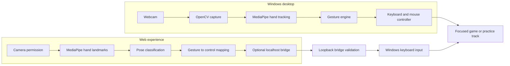

<div align="center">

# GESTURE / RACING
### Drive by instinct.

**A touchless gaming system that turns webcam hand gestures into real game controls.**

[](https://website-jet-tau-52.vercel.app/)
[](https://website-jet-tau-52.vercel.app/dashboard)
[](https://www.python.org/)
[](https://nextjs.org/)
[](LICENSE)

<br />

**No controller. No touch. Just motion.**

</div>

---

## The idea

Gesture / Racing is an open-source human-computer interaction project with two ways to play:

- **Web experience:** an animated project site, interactive keyboard-driving demo, game profiles, and a browser-based live cockpit.
- **Windows desktop controller:** a webcam hand-tracking app that translates gestures into keyboard and mouse input for a focused game.

The browser cockpit can also send controls through an optional **local Windows bridge**. The bridge runs on the player's computer; it is not a cloud game-control service. Camera frames are processed on the device and are not uploaded by this project.

> **Try it:** [Project website](https://website-jet-tau-52.vercel.app/) · [Live cockpit](https://website-jet-tau-52.vercel.app/dashboard)

## Product preview

The live site is the current visual demo. It includes the gesture-mapping selector, animated game profiles, an interactive practice track, and the live cockpit. The image files currently in the project folder are editor captures rather than product screenshots, so they are intentionally not shown as product UI. Capture camera-free product screenshots before adding them to the public repo.

| Experience | What to explore |
|---|---|
| [Project website](https://website-jet-tau-52.vercel.app/) | Motion-led landing page, gesture map, game selection, keyboard practice track |
| [Live cockpit](https://website-jet-tau-52.vercel.app/dashboard) | Camera preview, hand landmarks, recognition telemetry, local bridge, offline practice track |
| [Player sign-in screen](https://website-jet-tau-52.vercel.app/login) | Visual demo only; authentication is not implemented |

## Gesture controls

| Hand pose | Racing input | Notes |
|---|---|---|
| ☝️ Index finger pointing up | Accelerate / forward | Open palm is also accepted as forward in the browser cockpit |
| 👍 Thumb up | Nitro / game action | The key depends on the selected game profile |
| 👎 Thumb down | Reverse | Mapped to the selected game's reverse/brake key |
| ✊ Closed fist | Brake / stop | Releases when the pose changes or the controller stops |
| 👈 Index finger pointing left | Turn left | Can be held alongside throttle from the other hand |
| 👉 Index finger pointing right | Turn right | Can be held alongside throttle from the other hand |

The cockpit combines both hands into independent steering, pedal, and nitro states. A short bridge lease releases held inputs if fresh control messages stop arriving.

## How it works



### System boundaries

- **Browser camera path:** the user grants camera access, and MediaPipe runs locally in the browser. The model is served from this project; the MediaPipe WebAssembly runtime is loaded from jsDelivr.
- **Browser-to-game path:** the dashboard sends small control messages to `127.0.0.1:8765`. The optional Python bridge accepts configured origins and allowlisted controls, then emits OS keyboard events.
- **Desktop path:** the Windows app captures the camera through OpenCV, detects hand landmarks, maps gestures, and sends input locally.
- **Game boundary:** game controls only work when the target game is open and its play area has focus. External game URLs and key bindings can change independently of this repository.

## Tech stack

| Layer | Technologies |
|---|---|
| Web UI | Next.js 16, React 19, TypeScript, Tailwind CSS 4 |
| Motion and graphics | Framer Motion, Three.js, React Three Fiber, Drei, Lucide |
| Browser vision | MediaPipe Tasks Vision, browser `getUserMedia`, Canvas overlays |
| Desktop vision | Python 3.12, OpenCV, MediaPipe, NumPy |
| Desktop UI and input | Tkinter, PyAutoGUI, Windows `SendInput` |
| Hosting | Vercel for the web frontend; local Windows runtime for desktop input |
| Quality checks | Python `unittest`, ESLint, TypeScript, Next.js production build |

## Run it locally

### 1. Web frontend

Requires Node.js 22 LTS (the same major version used by the CI workflow).

```powershell
cd website
npm ci
npm run dev
```

Open [http://localhost:3000](http://localhost:3000). The homepage and practice track run without the Python bridge. Camera preview requires a supported browser and camera permission.

### 2. Windows desktop controller

From the repository root in PowerShell:

```powershell
cd gesture_racing_controller
py -3.12 -m venv .venv
.\.venv\Scripts\python.exe -m pip install -r requirements.txt
cd ..
run.bat
```

The desktop controller requires Windows and a working webcam for live hand tracking. Simulation mode is available without a camera. Use the in-app stop control or `Esc` to stop, and close the controller cleanly to release held inputs.

### 3. Optional browser-to-game bridge

The bridge is Windows-only. In another terminal, install the Python requirements as above, then launch:

```powershell
# From the repository root, after the Python environment above is installed:
.\gesture_racing_controller\.venv\Scripts\python.exe gesture_racing_controller\local_input_bridge.py
```

Or double-click `run_web_bridge.bat`. It listens only on `127.0.0.1:8765`. Open the cockpit, connect the game link, allow local network access if your browser asks, enable the camera, open a game, focus its play area, and start input.

**Keep the cockpit visible while playing.** Browsers can throttle camera processing in a hidden tab. Use side-by-side windows or the cockpit's floating camera preview when possible.

## Verify the project

```powershell
# Python checks
cd gesture_racing_controller
python -m unittest -v test_system.py

# Web lint and production build
cd ..\website
npm ci
npm run lint
npm run build
```

The Python suite currently covers gesture math, controller state transitions, emergency input release, game catalog integrity, settings persistence, and offline simulation. It does not replace a real-camera and real-game check on Windows.

## Repository map

```text
.
├── README.md
├── run.bat                         # Windows desktop app launcher
├── run_web_bridge.bat              # Optional browser-to-desktop bridge
├── website/                        # Next.js project site and live cockpit
│   ├── src/app/                    # Home, dashboard, login demo, styles
│   ├── src/components/             # Cockpit, dialogs, motion and UI
│   └── public/models/              # Browser hand-landmarker model
└── gesture_racing_controller/      # Python Windows controller
    ├── main.py                     # Desktop app entry point
    ├── gesture_engine.py           # OpenCV + MediaPipe tracking
    ├── game_controller.py          # Keyboard/mouse state management
    ├── local_input_bridge.py       # Loopback HTTP bridge
    ├── ui.py                       # Tkinter dashboard
    ├── games.py                    # Game profiles and mappings
    ├── config.py                   # Local preferences
    ├── requirements.txt
    └── test_system.py
```

## Security and privacy

- Camera access is initiated by the user. The website asks for video only and processes hand landmarks locally.
- The local bridge binds to loopback, validates request origins and control payloads, and automatically releases controls after its short input lease expires.
- The bridge can send keyboard input to the currently focused application. Use it only while intentionally playing, keep the bridge running only when needed, and stop it when finished.
- The public website is trusted by the bridge through its configured origin. This is a local demo trust model, not per-device authentication. A compromise of the trusted website could send the limited allowed game controls while the bridge is running.
- The `/login` page is a visual demo. It does not authenticate users, protect the dashboard, or store credentials.
- Local calibration/preferences are stored in `gesture_racing_controller/settings.json` and should remain local.

See [SECURITY.md](SECURITY.md) for responsible disclosure guidance.

## Current limitations

- The live game controls depend on each game's current keyboard mapping and focus behavior.
- Browser hand inference can slow down when the cockpit is in a background tab or the device is under load.
- Camera models and browser permission behavior vary by device and browser.
- The login screen is not backed by an authentication provider.
- Automated browser-to-game end-to-end tests and a dependency advisory scan are not included yet.

## Contributing

Bug reports, gesture-recognition improvements, accessibility fixes, and reproducible game profiles are welcome. Please read [CONTRIBUTING.md](CONTRIBUTING.md) before opening a pull request.

## License

MIT — see [LICENSE](LICENSE).

<div align="center">

**Built for the way you move.**

</div>
