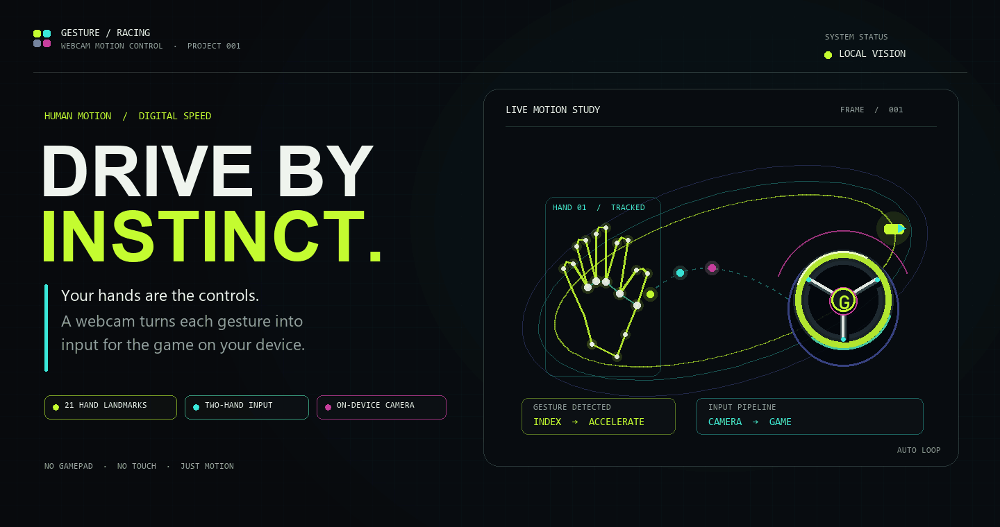
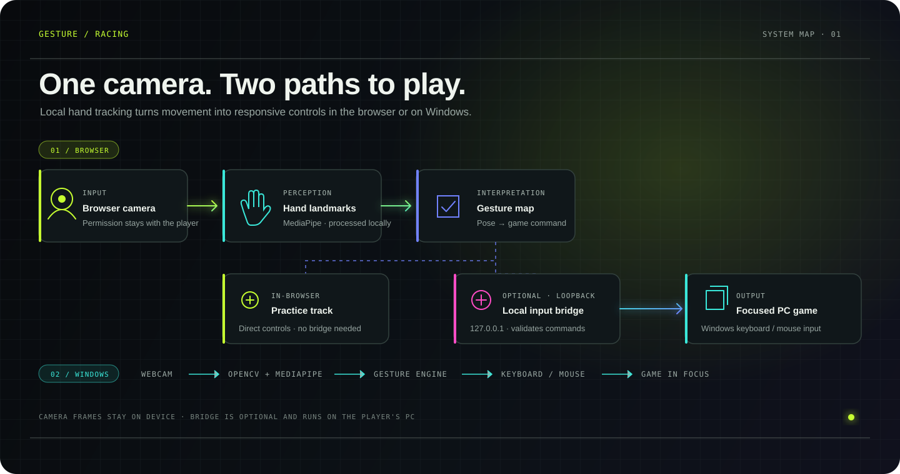

<div align="center">



# GESTURE / RACING

### **Drive by instinct.**

A webcam-powered controller that turns hand movement into game input.

<p>
  <a href="https://website-jet-tau-52.vercel.app/"><strong>↗&nbsp; Explore the project</strong></a>
  &nbsp;&nbsp;·&nbsp;&nbsp;
  <a href="https://website-jet-tau-52.vercel.app/dashboard"><strong>⌁&nbsp; Open the live cockpit</strong></a>
  &nbsp;&nbsp;·&nbsp;&nbsp;
  <a href="https://github.com/varanasisatya/gesture-racing-controller"><strong>⌘&nbsp; Browse the source</strong></a>
</p>

[](https://github.com/varanasisatya/gesture-racing-controller/actions/workflows/quality.yml)


[](LICENSE)

<br />

<sub>NO GAMEPAD &nbsp;·&nbsp; NO TOUCH &nbsp;·&nbsp; JUST MOTION</sub>

</div>

---

## 01 &nbsp; / &nbsp; The idea

**Gesture / Racing** makes your hands the controller. A camera tracks your hand pose, the gesture map turns it into a command, and the cockpit sends that command to a practice track or a game in focus.

Choose the experience that fits your setup:

| &nbsp; | **BROWSER COCKPIT** | **WINDOWS CONTROLLER** |
|:--|:--|:--|
| **Vision** | MediaPipe hand tracking in your browser | OpenCV + MediaPipe desktop tracking |
| **Play** | Built-in practice track, or optional local input bridge | Sends keyboard and mouse input to the focused game |
| **Setup** | Modern browser and camera permission | Windows, Python 3.12, and webcam |
| **Privacy** | Camera frames are processed on your device | Camera frames are processed on your computer |

> **The camera stays local.** The web app does not upload camera frames. The optional bridge runs on the same PC as the game and accepts commands over loopback.

## 02 &nbsp; / &nbsp; Motion language

The cockpit tracks hands independently. Use one to keep the car moving and the other to steer or trigger nitro.

| Hand pose | Game input | How it plays |
|:--|:--|:--|
| ☝️ **Index finger up** | Accelerate / forward | Hold to move |
| 👍 **Thumb up** | Nitro | Boost while accelerating |
| 👎 **Thumb down** | Reverse | Back up |
| ✊ **Closed fist** | Brake / stop | Slow down or stop |
| 👈 **Point left** | Turn left | Combine with acceleration on the other hand |
| 👉 **Point right** | Turn right | Combine with acceleration on the other hand |
| 🖐️ **Open palm** | Forward in browser cockpit | Alternate forward pose |

Exact key bindings depend on the selected game profile. External games must be focused and accept the mapped keys.

## 03 &nbsp; / &nbsp; How the signal moves

<p align="center">
  
</p>

## 04 &nbsp; / &nbsp; The experience

<table>
  <tr>
    <td width="50%" align="center" valign="top">
      <a href="https://website-jet-tau-52.vercel.app/">
        
      </a>
      <br /><br />
      <strong>01 — PROJECT WEBSITE</strong><br />
      <sub>Animated landing page · game profiles · interactive practice track</sub>
    </td>
    <td width="50%" align="center" valign="top">
      <a href="https://website-jet-tau-52.vercel.app/dashboard">
        
      </a>
      <br /><br />
      <strong>02 — LIVE COCKPIT</strong><br />
      <sub>Camera preview · hand landmarks · steering telemetry · game controls</sub>
    </td>
  </tr>
</table>

### Built for motion

| **LIVE COCKPIT** | **PRACTICE TRACK** | **DESKTOP CONTROLLER** |
|:--|:--|:--|
| Select a camera, see tracked hand landmarks, calibrate steering, and watch gesture telemetry update. | Try steering, acceleration, braking, reverse, and nitro without opening an external game. | Use the webcam to translate gestures into keyboard or mouse events for a focused Windows game. |

## 05 &nbsp; / &nbsp; Run it locally

### Web frontend

Requires Node.js 22 or later.

```powershell
cd website
npm ci
npm run dev
```

Open [http://localhost:3000](http://localhost:3000). The home page and practice track work without the Python bridge. Live hand tracking requires a supported browser, camera permission, and a webcam.

### Windows controller

From the repository root in PowerShell:

```powershell
cd gesture_racing_controller
py -3.12 -m venv .venv
.\.venv\Scripts\python.exe -m pip install -r requirements.txt
cd ..
run.bat
```

The desktop controller requires Windows and a webcam for live tracking. Use its stop control or press `Esc` to stop. Closing the controller releases held inputs.

### Optional browser-to-game bridge

Install the Python requirements as above, then run this from the repository root:

```powershell
.\gesture_racing_controller\.venv\Scripts\python.exe gesture_racing_controller\local_input_bridge.py
```

Or double-click `run_web_bridge.bat`. Then:

1. Open the cockpit and choose **Connect game**.
2. Allow the browser's local-network request if prompted.
3. Enable the camera and select a game profile.
4. Open a supported game, click its play area, and start input.
5. Keep the cockpit visible while driving; background tabs can throttle camera processing.

## 06 &nbsp; / &nbsp; Built with

| Layer | Tools |
|:--|:--|
| Web experience | Next.js 16 · React 19 · TypeScript · Tailwind CSS 4 |
| Motion and 3D | Framer Motion · Three.js · React Three Fiber · Lucide |
| Browser vision | MediaPipe Tasks Vision · `getUserMedia` · Canvas overlays |
| Windows vision | Python 3.12 · OpenCV · MediaPipe · NumPy |
| Desktop controls | Tkinter · PyAutoGUI · Windows `SendInput` |
| Hosting | Vercel frontend · optional local Windows game input |
| Quality checks | ESLint · TypeScript · Next.js production build · Python `unittest` |

## 07 &nbsp; / &nbsp; Privacy and safety

- Browser camera access starts only after the player grants permission. Hand landmarks are processed on the device.
- The optional bridge binds to `127.0.0.1:8765`, checks the configured website origin and allowed control payloads, and releases held keys when its short input lease expires.
- The bridge controls the currently focused application. Start it only while playing, and stop it when finished.
- The public website is trusted by the bridge in this demo setup. The bridge is local input tooling, not a cloud game-control service or per-device authenticated service.
- The `/login` screen is a visual demo. Authentication is not implemented and credentials are not stored.

## 08 &nbsp; / &nbsp; Quality checks

The GitHub Actions workflow runs web linting and a production build, plus the Windows controller's Python unit tests.

```powershell
cd gesture_racing_controller
python -m unittest -v test_system.py

cd ..\website
npm ci
npm run lint
npm run build
```

The suite covers gesture math, controller state transitions, emergency key release, game catalog integrity, settings persistence, and offline simulation. A live camera and real external game check still depends on the player's Windows device and chosen game.

## 09 &nbsp; / &nbsp; Repository map

```text
.
├── README.md
├── docs/
│   ├── assets/                  # Screenshots and README artwork
│   └── generate_readme_art.py   # Rebuild the animated cover (Pillow required)
├── run.bat                      # Windows controller launcher
├── run_web_bridge.bat           # Optional local input bridge
├── website/                     # Next.js project site and live cockpit
│   ├── src/app/                 # Home, dashboard, login demo, and styles
│   ├── src/components/          # Cockpit, dialogs, motion, and UI
│   └── public/models/           # Browser hand-landmarker model
└── gesture_racing_controller/   # Python Windows controller
    ├── main.py                  # Desktop app entry point
    ├── gesture_engine.py        # OpenCV + MediaPipe tracking
    ├── game_controller.py       # Keyboard/mouse state management
    ├── local_input_bridge.py    # Loopback HTTP bridge
    ├── ui.py                    # Tkinter dashboard
    ├── games.py                 # Game profiles and mappings
    └── test_system.py           # Unit tests
```

## Contributing

Gesture-recognition improvements, accessibility fixes, reproducible game profiles, and bug reports are welcome. See [CONTRIBUTING.md](CONTRIBUTING.md) before opening a pull request.

## Security

Please report security concerns privately using the process in [SECURITY.md](SECURITY.md).

## License

MIT. See [LICENSE](LICENSE).

<div align="center">

**BUILT FOR THE WAY YOU MOVE.**

<sub>GESTURE / RACING — HUMAN INPUT, DIGITAL SPEED</sub>

</div>
