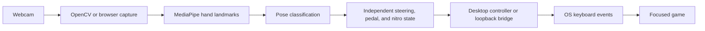

# Gesture / Racing — Technical Notes

This note describes the implementation present in this repository. It avoids benchmark claims that have not been measured in a repeatable environment. For the user-facing overview and setup, see the [root README](../README.md).

## Components

| Component | Responsibility |
|---|---|
| `gesture_engine.py` | Opens the webcam with OpenCV, runs MediaPipe hand tracking, classifies poses, and provides control state to the desktop UI. |
| `game_controller.py` | Latches and releases keyboard/mouse actions using PyAutoGUI and Windows `SendInput`. |
| `ui.py` | Tkinter desktop interface, camera controls, game profiles, and offline practice view. |
| `local_input_bridge.py` | Optional loopback HTTP endpoint for browser control messages. Validates origin, request size, action, game, and combined control fields. |
| `website/src/components/CockpitDashboard.tsx` | Browser camera preview, MediaPipe tracking, gesture overlay, telemetry, and optional bridge client. |
| `website/src/app/page.tsx` | Public project site and keyboard-driven practice demo. |

## Control flow

The browser cockpit uses browser camera permission and performs landmark inference locally. When the optional bridge is enabled, it sends a small JSON control message to `127.0.0.1:8765`. The Python bridge is Windows-only and applies the allowed inputs to the currently focused application. It uses a short lease to release held keys if updates stop.

## Current gesture map

| Gesture | Control |
|---|---|
| Index pointing up or open palm | Accelerate / forward |
| Thumb up | Nitro / game-specific action |
| Thumb down | Reverse |
| Closed fist | Brake / stop |
| Index pointing left / right | Steer left / right |

The browser controller can combine steering, pedal, and nitro across two hands. Individual external games may use different keyboard bindings.

## Verification status

The current Python `unittest` suite covers pose/angle calculations, controller state transitions, emergency input release, game catalog integrity, persistence, and offline simulation. The web project exposes ESLint, TypeScript, and production-build checks. These checks do not replace testing on Windows with the intended camera and each target game.

## Known limitations

- Inference speed depends on the camera, browser, CPU/GPU, and whether the cockpit tab is visible.
- The browser-to-bridge trust relationship is based on an origin allowlist, not per-device pairing.
- The sign-in page is a visual placeholder; no authentication backend is configured.
- Game launch URLs and key mappings depend on third-party games and may change.
- No repeatable performance benchmark or browser-to-game end-to-end test suite is currently included.